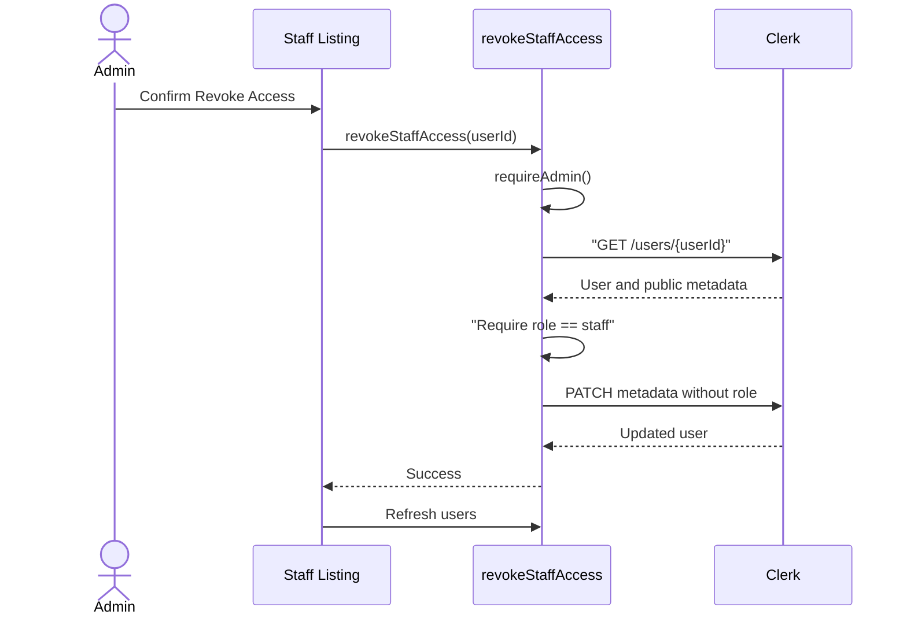

# Split Staff Management into Staff/Admin tables, add revoke access

## Summary
- Splits the Manage Staff page into two tables — Staff and Admin — reading the same live Clerk-backed data, grouped by role, instead of one combined table.
- Adds a "Revoke Access" action on the Staff table only, which clears a Staff account's role via Clerk (`revokeStaffAccess`) without deleting the underlying Clerk account, so access is restorable via re-invite. Server-side guarded to reject revoking an Admin.
- Records the "Revoke Access" term in `CONTEXT.md` (distinct from full account deletion) and adds `docs/adr/0001-staff-accounts-live-in-clerk-only.md` explaining why Staff data stays Clerk-only rather than mirrored into Convex like Participants.

Not in this PR (tracked separately, needs Clerk Dashboard access, not code): enabling required First/Last name fields on the invite-acceptance sign-up screen, and confirming password auth is the enabled sign-in strategy.

## Test plan
- [x] `npm run typecheck` / `npm run typecheck:convex`
- [x] `npm run lint`
- [x] `npm run format:check`
- [x] `npm run test` (94 passing, incl. 3 new `revokeStaffAccess` cases: rejects Staff caller, rejects revoking an Admin, clears role while preserving other metadata)
- [x] `npm run build`
- [ ] Manual check of the split Staff/Admin tables and Revoke Access flow in the browser (blocked here by Clerk sign-in — needs a run against a real logged-in Admin session)

🤖 Generated with [Claude Code](https://claude.com/claude-code)

<!-- greptile_comment -->

<h3>Greptile Summary</h3>

The PR splits Clerk-backed users into Staff and Admin tables and adds an Admin-only action that removes a Staff role without deleting the Clerk account.
- Adds the `revokeStaffAccess` Convex action and function-seam tests.
- Adds the split table UI, confirmation flow, and role-based grouping.
- Documents the Revoke Access vocabulary and Clerk-only account architecture.

<h3>Confidence Score: 2/5</h3>

The PR should not merge until role-less account grouping, pending-dialog dismissal, and concurrent role updates are handled safely.

The changed UI exposes an operation guaranteed to fail for role-less and newly revoked users, can make an in-flight revocation appear cancelled, and the server action can revoke a user from a stale role snapshot after a concurrent promotion.

**Files Needing Attention:** src/features/staff/components/staff-listing.tsx and convex/staffAccounts.ts

<h3>Important Files Changed</h3>

| Filename | Overview |
|----------|----------|
| convex/staffAccounts.ts | Adds a server-guarded revoke action, but its GET/check/PATCH sequence can overwrite a concurrent role change and bypass the intended current-role safeguard. |
| convex/staffAccounts.test.ts | Adds focused tests covering caller authorization, Admin-target rejection, and preservation of unrelated metadata. |
| src/features/staff/components/staff-listing.tsx | Splits the listing and adds revoke controls, but misclassifies role-less users and permits dismissal while revocation remains in flight. |
| CONTEXT.md | Defines Revoke Access consistently as role removal rather than account deletion. |
| docs/adr/0001-staff-accounts-live-in-clerk-only.md | Records the decision to retain Clerk as the sole Staff and Admin account store. |

<h3>Sequence Diagram</h3>

<a href="https://app.greptile.com/api/ide/codex?prompt=IMPORTANT%3A%20Work%20in%20the%20repository%20%22decker7%2Fmini-trip-management-system%22%2
