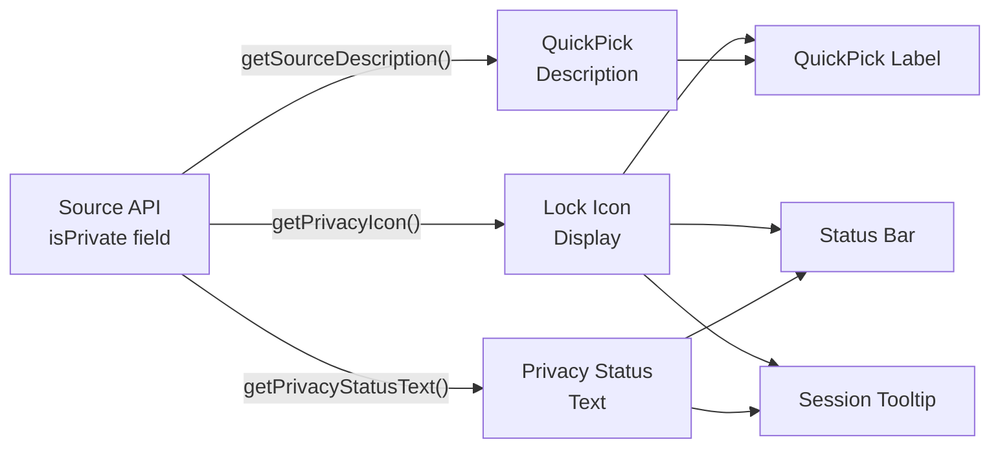

# Add private repository icon display using isPrivate field

### **User description**
The `isPrivate` field from `sources.list` API was defined but unused. This adds visual indicators for private repositories across the UI.

## Changes

### Type Definition
- Added optional `isPrivate?: boolean` to `Source` interface

### UI Implementation
- **QuickPick**: Shows `$(lock)` icon prefix for private repos, displays "Private" in description
- **Status Bar**: Shows `$(lock)` icon for private sources, adds privacy status to tooltip
- **TreeView**: Displays privacy status in session tooltips with appropriate icon

### Utility Functions
Added three helper functions to ensure consistent privacy status handling:
```typescript
getPrivacyIcon(isPrivate?: boolean): string
getPrivacyStatusText(isPrivate?: boolean, format: 'short' | 'long'): string
getSourceDescription(source: SourceType): string
```

### State Handling
Explicitly handles three states with `=== true/false` comparisons:
- `true`: Show lock icon and "Private" label
- `false`: Show "Public" label (no icon)
- `undefined`: No privacy indication (unknown state)

### Tests
Added unit tests covering all three `isPrivate` states in `types.unit.test.ts`.

<!-- START COPILOT ORIGINAL PROMPT -->


<details>

<summary>Original prompt</summary>

> 
> ----
> 
> *This section details on the original issue you should resolve*
> 
> <issue_title>ソース選択・現在のソースにプライベートアイコン表示</issue_title>
> <issue_description>## 背景
> 
> `sources.list`で取得できる`isPrivate`フィールドが型定義のみで未使用．プライベートリポジトリを視覚的に識別できるようにする．
> 
> ---
> 
> ## API仕様（公式ドキュメントより）
> 
> <aside>
> 📚
> 
> **Sourceオブジェクト**
> 
> `isPrivate`: `boolean` - リポジトリがプライベートかどうか
> 
> **公式ドキュメント**: [[REST Resource: sources](https://developers.google.com/jules/api/reference/rest/v1alpha/sources)](https://developers.google.com/jules/api/reference/rest/v1alpha/sources)
> 
> </aside>
> 
> ### Source構造
> 
> ```json
> {
>   "name": "sources/{source}",
>   "displayName": string,
>   "gitHubRepository": {
>     "owner": string,
>     "name": string
>   },
>   "isPrivate": boolean  // ← このフィールドを活用
> }
> ```
> 
> ---
> 
> ## 実装方針
> 
> 1. **型定義の確認**:
>     - `types.ts`の`Source`インターフェースに`isPrivate`が定義されているか確認
>     - なければ追加
> 2. **ソース選択UI（QuickPick）での表示**:
>     - セッション作成時のリポジトリ選択で🔒アイコンを付与
>     - 例: `🔒 owner/private-repo` vs `owner/public-repo`
> 3. **現在のソース表示（TreeView）での表示**:
>     - セッション一覧のTreeViewでソース名の横に🔒アイコン
>     - または`$(lock)`アイコン（VSCode Codicons）を使用
> 4. **ツールチップの追加**:
>     - ホバー時に「Private Repository」と表示
> 
> ---
> 
> ## VSCode Codiconsの使用
> 
> ```tsx
> // TreeItemでの使用例
> this.iconPath = new vscode.ThemeIcon('lock');
> 
> // QuickPickItemでの使用例
> {
>   label: source.isPrivate ? `$(lock) ${source.displayName}` : source.displayName,
>   description: source.isPrivate ? 'Private' : 'Public'
> }
> ```
> 
> ---
> 
> 絵文字じゃなくて，vscodeとかであるアイコンにして
> ## 完了条件
> 
> - [ ]  `Source`型に`isPrivate`フィールドがある
> - [ ]  ソース選択（QuickPick）でプライベートリポジトリに🔒アイコンが表示される
> - [ ]  セッションTreeViewでプライベートリポジトリに🔒アイコンが表示される
> - [ ]  ホバー時にプライベート/パブリックが分かるツールチップが表示される</issue_description>
> 
> <agent_instructions>日本語で</agent_instructions>
> 
> ## Comments on the Issue (you are @copilot in this section)
> 
> <comments>
> </comments>
> 


</details>


<!-- START COPILOT CODING AGENT SUFFIX -->

- Fixes is0692vs/jules-extension#263

<!-- START COPILOT CODING AGENT TIPS -->
---

✨ Let Copilot coding agent [set things up for you](https://github.com/is0692vs/jules-extension/issues/new?title=✨+Set+up+Copilot+instructions&body=Configure%20instructions%20for%20this%20repository%20as%20documented%20in%20%5BBest%20practices%20for%20Copilot%20coding%20agent%20in%20your%20repository%5D%28https://gh.io/copilot-coding-agent-tips%29%2E%0A%0A%3COnboard%20this%20repo%3E&assignees=copilot) — coding agent works faster and does higher quality work when set up for your repo.


___

### **PR Type**
Enhancement


___

### **Description**
- Add visual privacy indicators for repositories across UI components

- Implement three utility functions for consistent privacy status handling

- Display lock icon in QuickPick, status bar, and session tree tooltips

- Add comprehensive unit tests for Source type isPrivate field


___

### Diagram Walkthrough





<details><summary><h3>File Walkthrough</h3></summary>

<table><thead><tr><th></th><th align="left">Relevant files</th></tr></thead><tbody><tr><td><strong>Enhancement</strong></td><td><table>
<tr>
  <td>
    <details>
      <summary><strong>extension.ts</strong><dd><code>Add privacy indicators and utility functions</code>&nbsp; &nbsp; &nbsp; &nbsp; &nbsp; &nbsp; &nbsp; &nbsp; &nbsp; &nbsp; &nbsp; &nbsp; &nbsp; </dd></summary>
<hr>

src/extension.ts

<ul><li>Added three utility functions: <code>getPrivacyIcon()</code>, <br><code>getPrivacyStatusText()</code>, and <code>getSourceDescription()</code> for consistent <br>privacy handling<br> <li> Updated QuickPick source selection to display lock icon for private <br>repos and extract repository names<br> <li> Enhanced status bar to show lock icon and privacy status for selected <br>source<br> <li> Modified SessionTreeItem constructor to accept selectedSource <br>parameter and display privacy indicators in tooltips<br> <li> Updated source description logic to handle three isPrivate states <br>(true, false, undefined)</ul>


</details>


  </td>
  <td><a href="https://github.com/is0692vs/jules-extension/pull/264/files#diff-04bba6a35cad1c794cbbe677678a51de13441b7a6ee8592b7b50be1f05c6f626">+60/-12</a>&nbsp; </td>

</tr>

<tr>
  <td>
    <details>
      <summary><strong>types.ts</strong><dd><code>Add isPrivate field to Source type</code>&nbsp; &nbsp; &nbsp; &nbsp; &nbsp; &nbsp; &nbsp; &nbsp; &nbsp; &nbsp; &nbsp; &nbsp; &nbsp; &nbsp; &nbsp; &nbsp; &nbsp; &nbsp; &nbsp; &nbsp; &nbsp; &nbsp; &nbsp; </dd></summary>
<hr>

src/types.ts

- Added optional `isPrivate?: boolean` field to Source interface


</details>


  </td>
  <td><a href="https://github.com/is0692vs/jules-extension/pull/264/files#diff-c54113cf61ec99691748a3890bfbeb00e10efb3f0a76f03a0fd9ec49072e410a">+1/-0</a>&nbsp; &nbsp; &nbsp; </td>

</tr>
</table></td></tr><tr><td><strong>Tests</strong></td><td><table>
<tr>
  <td>
    <details>
      <summary><strong>types.unit.test.ts</strong><dd><code>Add unit tests for Source isPrivate field</code>&nbsp; &nbsp; &nbsp; &nbsp; &nbsp; &nbsp; &nbsp; &nbsp; &nbsp; &nbsp; &nbsp; &nbsp; &nbsp; &nbsp; &nbsp; &nbsp; </dd></summary>
<hr>

src/test/types.unit.test.ts

<ul><li>Created new test suite for Source type with four test cases<br> <li> Tests cover isPrivate as true, false, undefined, and with all Source <br>fields<br> <li> Validates proper type handling and field assignments</ul>


</details>


  </td>
  <td><a href="https://github.com/is0692vs/jules-extension/pull/264/files#diff-77095c71cfd489e27c23dfb92271e926a3428fbc34a335fbae238808bd32bfee">+62/-0</a>&nbsp; &nbsp; </td>

</tr>
</table></td></tr></tbody></table>

</details>

___
