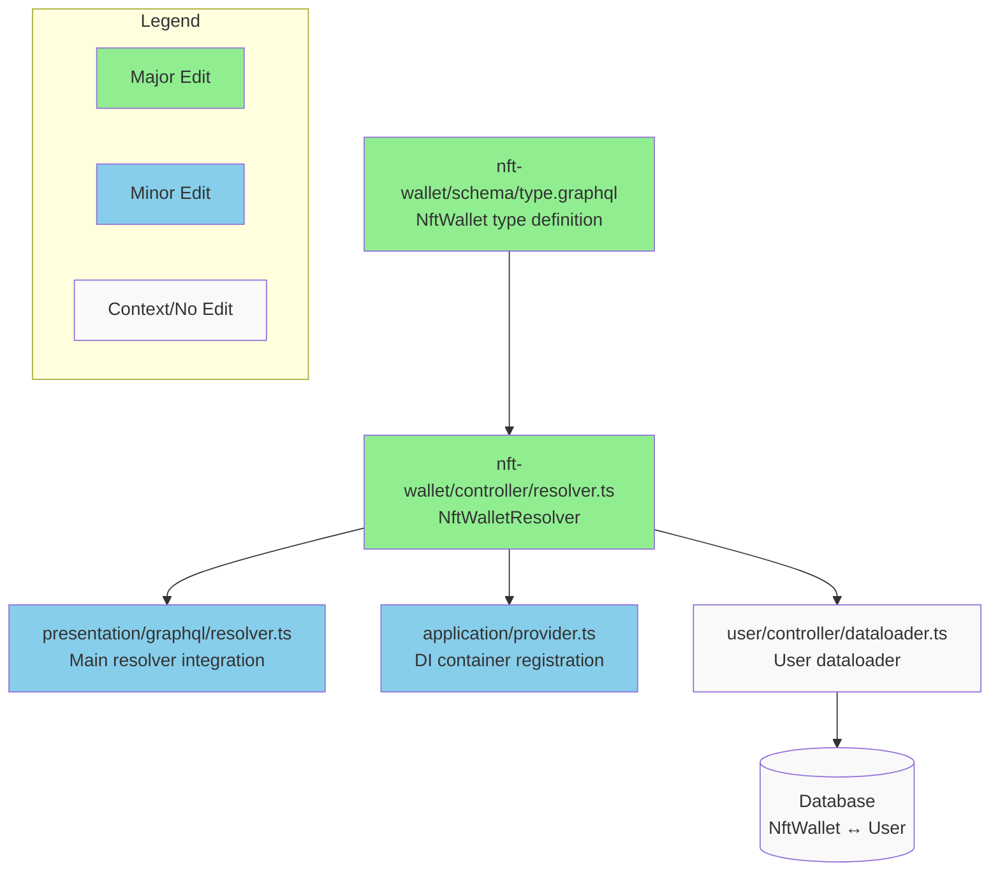

# feat: NFT一覧/詳細を取得できるQueryを作成する

# Add user field to NftWallet GraphQL type

## Summary

This PR extends the GraphQL response to include `NftInstance.nftWallet.user` data as requested. The implementation adds a `user` field to the NftWallet GraphQL type and creates the necessary resolver to load user data efficiently using existing dataloader patterns.

**Key Changes:**
- Added `user: User!` field to NftWallet GraphQL schema
- Created `NftWalletResolver` with user field implementation
- Integrated NftWallet resolver into main GraphQL resolver system
- Added dependency injection registration for the new resolver

The implementation follows the same pattern used by other domain resolvers (Wallet, Membership) for loading related user data, ensuring consistency with the existing codebase architecture.

## Review & Testing Checklist for Human

- [ ] **Verify database relationship**: Confirm that `NftWallet` table has `userId` field and the relationship to `User` table exists in the Prisma schema
- [ ] **Test GraphQL query end-to-end**: Execute a query like `nftInstances { edges { node { nftWallet { user { id name } } } } }` to verify the user field returns correct data
- [ ] **Check type safety**: Verify that `PrismaNftWalletDetail` type includes the `userId` field that the resolver depends on
- [ ] **Validate dataloader efficiency**: Use GraphQL query introspection or logging to ensure no N+1 query issues when loading multiple NFT instances with user data

**Recommended Test Plan:**
1. Start the GraphQL server locally
2. Execute the test query in GraphQL playground/Postman
3. Check server logs for any database query patterns indicating N+1 issues
4. Verify that user data is correctly populated for NFT wallet owners

---

### Diagram

### Notes

- The implementation assumes the `userId` field exists on `PrismaNftWalletDetail` type - this should be verified during review
- GraphQL generation completed successfully, indicating schema integration is correct
- No automated tests exist for GraphQL functionality, making manual testing critical
- The resolver pattern exactly matches existing implementations in Wallet and Membership domains

**Session Info:** https://app.devin.ai/sessions/b84f662d8c204db2bff4dd7095c5a379  
**Requested by:** @sigma-xing2
