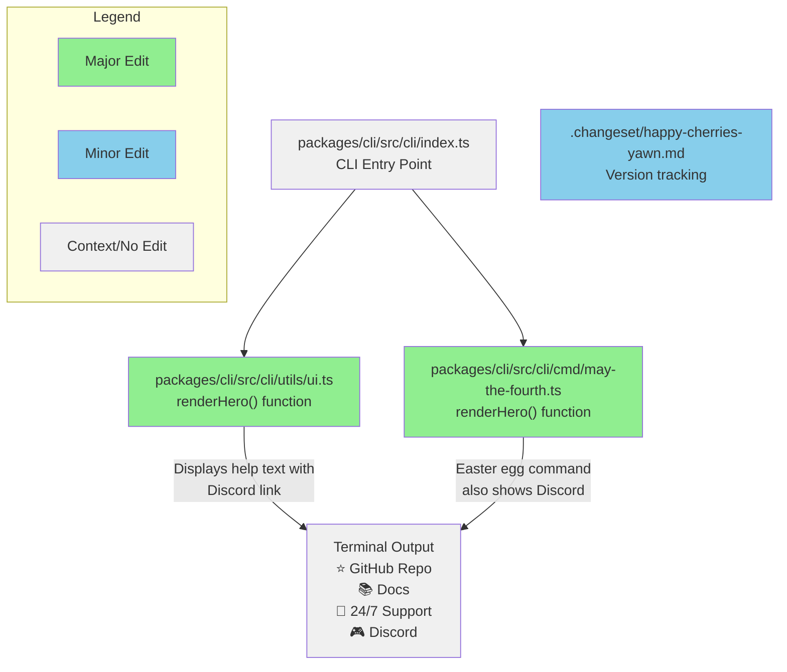

# feat: add Discord link to CLI help text

# feat: add Discord link to CLI help text

## Summary
Added Discord link `🎮 Discord: https://lingo.dev/go/discord` to CLI help text that appears when users run various CLI commands. The link is positioned after the existing "💬 24/7 Support" line to maintain logical flow of contact information.

**Changes made:**
- Updated `packages/cli/src/cli/utils/ui.ts` renderHero() function to include Discord link with proper formatting and alignment
- Updated `packages/cli/src/cli/cmd/may-the-fourth.ts` renderHero() function to maintain consistency in the easter egg command
- Applied Prettier formatting to ensure code style compliance
- Added changeset for minor version bump tracking

## Review & Testing Checklist for Human
- [ ] **Test multiple CLI commands** - Run various commands like `pnpm lingo.dev login`, `pnpm lingo.dev logout`, `pnpm lingo.dev run` to verify Discord link appears correctly formatted and visually aligned with existing contact info
- [ ] **Verify Discord URL** - Confirm `https://lingo.dev/go/discord` redirects to the correct/official Lingo.dev Discord server
- [ ] **Check for missed locations** - Search codebase to ensure no other help text locations need the Discord link added
- [ ] **Visual alignment verification** - Ensure the new Discord line aligns perfectly with existing GitHub, Docs, and Support lines in the terminal output

---

### Diagram

### Notes
- CI checks now pass after adding required changeset file and Prettier formatting
- Limited testing was performed (only verified via `login` command) - comprehensive testing recommended
- Discord URL verified to redirect correctly to Lingo.dev Discord server
- Session URL: https://app.devin.ai/sessions/5ab5628adbfb431b8988f58e9f986161
- Requested by: Max Prilutskiy (@maxprilutskiy)
