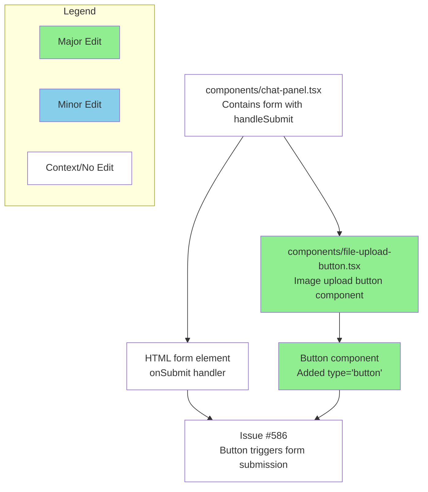

# fix: prevent image upload button from triggering form submission

# fix: prevent image upload button from triggering form submission

## Summary

Fixed issue #586 where clicking the image upload button (paperclip icon) would trigger form submission when text was already entered in the chat input field. The fix adds `type="button"` to the Button component in `FileUploadButton` to prevent it from defaulting to submit behavior when clicked inside a form.

**Root Cause**: HTML buttons inside forms default to `type="submit"` when no type is specified. The FileUploadButton component is rendered inside the chat form, so clicking it was triggering form submission instead of just opening the file dialog.

**Solution**: Added `type="button"` attribute to the Button component, following the same pattern used by other non-submit buttons in the codebase (like the "New Chat" button and "Scroll to Bottom" button).

## Review & Testing Checklist for Human

⚠️ **Critical**: I was unable to test this fix locally due to missing DATABASE_URL environment variable, so end-to-end testing is essential.

- [ ] **Test the bug scenario**: Enter text in the chat input field, then click the image upload button (paperclip icon). Verify that the file selection dialog opens WITHOUT submitting the form/sending the message.
- [ ] **Test file upload functionality**: Select and upload an image file to ensure the upload process still works correctly after the fix.  
- [ ] **Test form submission**: Verify that the actual submit button (arrow icon) still properly submits the form when clicked.
- [ ] **Code review**: Confirm that adding `type="button"` is the correct approach and aligns with how other buttons in the chat panel are implemented.

---

### Diagram

### Notes

- This follows the established pattern in the codebase where other buttons that shouldn't submit forms explicitly use `type="button"` (see chat-panel.tsx lines 160, 222)
- The change is minimal (1 line) but addresses a core UX issue where users couldn't upload images without accidentally sending incomplete messages
- **Environment Issue**: Local testing was blocked by missing DATABASE_URL configuration, highlighting the importance of proper dev environment setup

**Link to Devin run**: https://app.devin.ai/sessions/2647080437fa4fc4a47e8b78d49f0b8b  
**Requested by**: @miurla (Yoshiki Miura)
