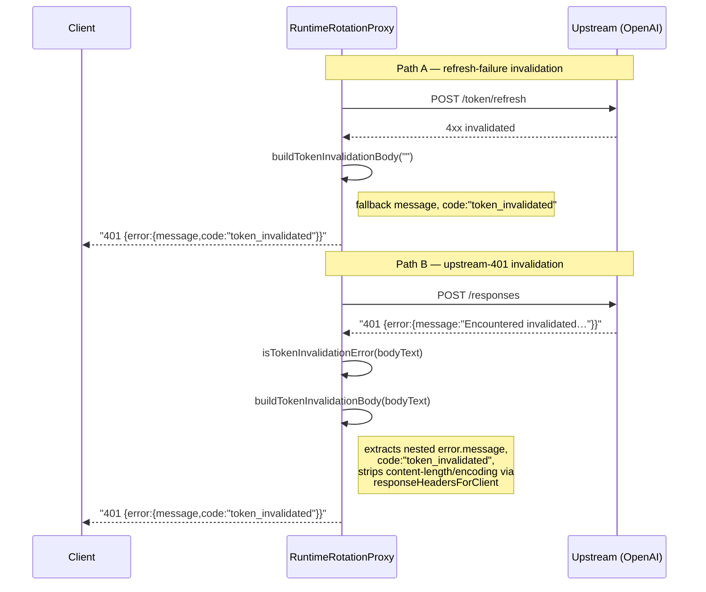

# fix(runtime): emit consistent token_invalidated body on upstream-401 path

## Summary

Follow-up to #496. Addresses the unresolved Greptile review concerns from that PR's post-merge audit.

The core anti-cascade behavior shipped in #496 is correct, but two contract/robustness items remained:

**1. Asymmetric 401 body (Greptile P3 → fixed)**
The refresh-failure invalidation path synthesised `{error:{message,code:"token_invalidated"}}`, but the **upstream-401** invalidation path forwarded the raw OpenAI body verbatim — which carries no guaranteed `code`. A client (or operator tooling) keying off `error.code` to distinguish "explicitly invalidated" from a generic 401 would catch one path and silently miss the other.

- New `buildTokenInvalidationBody()` wraps **both** paths in the same `{error:{message,code:"token_invalidated"}}` shape.
- Preserves the upstream human-readable `message` when present (`error.message` or top-level `message`); falls back to a stable message for non-JSON bodies — no HTML/markup is echoed back to clients.
- Forces `content-type: application/json` and drops stale `content-length`/`content-encoding` (via the existing `responseHeadersForClient`) since the body is rewritten.

**2. Clock-domain guard (Greptile P2 on `now()` → documented, no behavior change)**
`applyMonotonicAuthCooldown` deliberately uses `Date.now()` rather than the proxy's injected `now()`, because it compares against `coolingDownUntil`, which is written via `markAccountCoolingDown` → `nowMs()` (== `Date.now()`). Both sides must share the real-wall-clock domain; switching to the injected `now()` would mis-compare an injected-clock value against a real-clock deadline and silently defeat the monotonic cooldown race protection. Added a comment so this isn't "fixed" into a regression.

> Note on the P2 concurrency race (generic-401 clobbering the 5-min invalidation cooldown): already correctly closed in #496 — `applyMonotonicAuthCooldown` only extends, never shortens, and runs synchronously on both auth-failure paths. No code change needed here.

## Test plan

- [x] Strengthened the existing upstream-401 invalidation test to assert `error.code === "token_invalidated"` **and** that the upstream message is preserved.
- [x] Strengthened the HTML-body test to assert the consistent `code` and the stable fallback message (no markup leaked).
- [x] `tsc --noEmit`: clean
- [x] `eslint` (ts + scripts): clean
- [x] `npm run build`: clean
- [x] Full suite: **4054 tests pass** (`vitest run --maxWorkers=1`)

🤖 Generated with [Claude Code](https://claude.com/claude-code)

<!-- greptile_comment -->

**note:** greptile review for oc-chatgpt-multi-auth. cite files like `lib/foo.ts:123`. confirm regression tests + windows concurrency/token redaction coverage.
---


<h3>Greptile Summary</h3>

this pr closes the two unresolved contract items from the #496 post-merge audit: it unifies the 401 response body across both token-invalidation vectors (refresh-failure and upstream-401) through a shared `buildTokenInvalidationBody()` builder, and documents why `applyMonotonicAuthCooldown` intentionally uses `Date.now()` rather than the injected clock.

- `buildTokenInvalidationBody()` normalises both exit paths to `{ error: { message, code: "token_invalidated" } }`, extracting the upstream human-readable message (top-level or nested `error.message`) and falling back to a stable string for non-json/html bodies; `content-length` and `content-encoding` are stripped by the existing `responseHeadersForClient` helper before the rewritten body is sent.
- the refresh-failure path now calls `buildTokenInvalidationBody("")` instead of inline literals, so the two paths share a single source of truth for both the code string and the fallback message.
- eight focused unit tests for `buildTokenInvalidationBody` cover all extraction branches, and the two integration tests are strengthened to assert `error.code` and the preserved/fallback message.

<h3>Confidence Score: 5/5</h3>

safe to merge — both invalidation exit paths now share a single builder with consistent output, all extraction branches are unit-tested, and neither the clock-domain guard nor header handling introduce regressions.

the change is narrow and surgical: a pure body-normalisation layer that falls back safely for any upstream input, with the existing `responseHeadersForClient` correctly stripping stale `content-length` and `content-encoding` before the rewritten json body is sent. both previously reported contract gaps are closed, unit coverage now exercises all message-extraction branches, and the two integration tests verify end-to-end shape on both vectors.

no files require special attention

<h3>Important Files Changed</h3>


| Filename | Overview |
|----------|----------|
| lib/runtime-rotation-proxy.ts | adds `buildTokenInvalidationBody()` builder with correct message extraction and fallback; wires both invalidation exit paths through it; adds a clock-domain comment on `applyMonotonicAuthCooldown`; no new issues found |
| test/runtime-rotation-proxy.test.ts | strengthens two existing integration tests to assert `error.code`/`error.message`; adds a dedicated `buildTokenInvalidationBody` describe block covering all five extraction branches including the previously untested nested and priority cases |

</details>


<h3>Sequence Diagram</h3>



<!-- greptile_failed_comments -->
<details><summary><h3>Comments Outside Diff (2)</h3></summary>

1. `lib/runtime-rotation-proxy.ts`, line 1558-1566 ([link](https://github.com/ndycode/codex-multi-auth/blob/3180f019daf7b78f9a10d1981f9ce3e102e6e8f6/lib/runtime-rotation-proxy.ts#L1558-L1566)) 

   <a href="#"></a> **refresh-failure path still uses hardcoded literals**

   `TOKEN_INVALIDATED_CODE` and `TOKEN_INVALIDATED_FALLBACK_MESSAGE` are introduced in this PR but never consumed at the refresh-failure exit point (line 1558–1565). if either constant drifts (even a capitalisation fix), the two invalidation paths silently emit different strings again — exactly the asymmetry this PR exists to prevent. the fix is to replace the inline literals with the new constants (or call `buildTokenInvalidationBody("")` to also go through the shared builder).

   <details><summary>Prompt To Fix With AI</summary>

   `````markdown
   This is a comment left during a code review.
   Path: lib/runtime-rotation-proxy.ts
   Line: 1558-1566

   Comment:
   **refresh-failure path still uses hardcoded literals**

   `TOKEN_INVALIDATED_CODE` and `TOKEN_INVALIDATED_FALLBACK_MESSAGE` are introduced in this PR but never consumed at the refresh-failure exit point (line 1558–1565). if either constant drifts (even a capitalisation fix), the two invalidation paths silently emit different strings again — exactly the asymmetry this PR exists to prevent. the fix is to replace the inline literals with the new constants (or call `buildTokenInvalidationBody("")` to also go through the shared builder).

   How can I resolve this? If you propose a fix, please make it concise.
   `````
   </details>

   <a href="https://chatgpt.com/codex/deeplink?prompt=IMPORTANT%3A%20Work%20in%20the%20repository%20%22ndycode%2Fcodex-multi-auth%22%20on%20the%20existing%20branch%20%22fix%2F496-followup-invalidation-contract%22.%20Checkout%20that%20branch%20%E2%80%94%20do%20NOT%20create%20a%20new%20branch%20or%20open%20a%20new%20PR.%20Push%20your%20changes%20to%20%22fix%2F496-followup-invalidation-contract%22.%0A%0AThis%20is%20a%20comment%20left%20during%20a%20code%20review.%0APath%3A%20lib%2Fruntime-rotation-proxy.ts%0ALine%3A%201558-1566%0A%0AComment%3A%0A**refresh-failure%20path%20still%20uses%20hardcoded%20literals**%0A%0A%60TOKEN_INVALIDATED_CODE%60%20and%20%60TOKEN_INVALIDATED_FALLBACK_MESSAGE%60%20are%20introduced%20in%20this%20PR%20but%20never%20consumed%20at%20the%20refresh-failure%20exit%20point%20%28line%201558%E2%80%931565%29.%20if%20either%20constant%20drifts%20%28even%20a%20capitalisation%20fix%29%2C%20the%20two%20invalidation%20paths%20silently%20emit%20different%20strings%20again%20%E2%80%94%20exactly%20the%20asymmetry%20this%20PR%20exists%20to%20prevent.%20the%20fix%20is%20to%20replace%20the%20inline%20literals%20with%20the%20new%20constants%20%28or%20call%20%60buildTokenInvalidationBody%28%22%22%29%60%20to%20also%20go%20through%20the%20shared%20builder%29.%0A%0AHow%20can%20I%20resolve%20this%3F%20If%20you%20propose%20a%20fix%2C%20please%20make%20it%20concise."><picture><source media="(prefers-color-scheme: dark)" srcset="https://greptile-static-assets.s3.amazonaws.com/badges/FixInCodexDark.svg?v=3"><source media="(prefers-color-scheme: light)" srcset="https://greptile-static-assets.s3.amazonaws.com/badges/FixInCodex.svg?v=3"></picture></a>

2. `test/runtime-rotation-proxy.test.ts`, line 1857-1870 ([link](https://github.com/ndycode/codex-multi-auth/blob/3180f019daf7b78f9a10d1981f9ce3e102e6e8f6/test/runtime-rotation-proxy.test.ts#L1857-L1870)) 

   <a href="#"></a> **unit coverage gap for `buildTokenInvalidationBody` branches**

   the new function has five distinct message-extraction branches (top-level `message`, nested `error.message`, whitespace-only non-empty string, blank/falsy `message` with populated `error.message`, non-JSON body). the integration tests added here exercise the top-level-message and non-JSON-fallback paths, but the nested `error.message` branch and the "top-level wins over nested" priority rule are untested at unit level. if the extraction priority is ever adjusted, no unit test will catch the regression.

   <details><summary>Prompt To Fix With AI</summary>

   `````markdown
   This is a comment left during a code review.
   Path: test/runtime-rotation-proxy.test.ts
   Line: 1857-1870

   Comment:
   **unit coverage gap for `buildTokenInvalidationBody` branches**

   the new function has five distinct message-extraction branches (top-level `message`, nested `error.message`, whitespace-only non-empty string, blank/falsy `message` with populated `error.message`, non-JSON body). the integration tests added here exercise the top-level-message and non-JSON-fallback paths, but the nested `error.message` branch and the "top-level wins over nested" priority rule are untested at unit level. if the extraction priority is ever adjusted, no unit test will catch the regression.

   How can I resolve this? If you propose a fix, please make it concise.
   `````
   </details>

   Note: If this suggestion doesn't match your team's coding style, reply to this and let me know. I'll remember it for next time!

   <a href="https://chatgpt.com/codex/deeplink?prompt=IMPORTANT%3A%20Work%20in%20the%20repository%20%22ndycode%2Fcodex-multi-auth%22%20on%20the%20existing%20branch%20%22fix%2F496-followup-invalidation-contract%22.%20Checkout%20that%20branch%20%E2%80%94%20do%20NOT%20create%20a%20new%20branch%20or%20open%20a%20new%20PR.%20Push%20your%20changes%20to%20%22fix%2F496-followup-invalidation-contract%22.%0A%0AThis%20is%20a%20comment%20left%20during%20a%20code%20review.%0APath%3A%20test%2Fruntime-rotation-proxy.test.ts%0ALine%3A%201857-1870%0A%0AComment%3A%0A**unit%20coverage%20gap%20for%20%60buildTokenInvalidationBody%60%20branches**%0A%0Athe%20new%20function%20has%20five%20distinct%20message-extraction%20branches%20%28top-level%20%60message%60%2C%20nested%20%60error.message%60%2C%20whitespace-only%20non-empty%20string%2C%20blank%2Ffalsy%20%60message%60%20with%20populated%20%60error.message%60%2C%20non-JSON%20body%29.%20the%20integration%20tests%20added%20here%20exercise%20the%20top-level-message%20and%20non-JSON-fallback%20paths%2C%20but%20the%20nested%20%60error.message%60%20branch%20and%20the%20%22top-level%20wins%20over%20nested%22%20priority%20rule%20are%20untested%20at%20unit%20level.%20if%20the%20extraction%20priority%20is%20ever%20adjusted%2C%20no%20unit%20test%20will%20catch%20the%20regression.%0A%0AHow%20can%20I%20resolve%20this%3F%20If%20you%20propose%20a%20fix%2C%20please%20make%20it%20concise."><picture><source media="(prefers-color-scheme: dark)" srcset="https://greptile-static-assets.s3.amazonaws.com/badges/FixInCodexDark.svg?v=3"><source media="(prefers-color-scheme: light)" srcset="https://greptile-static-assets.s3.amazonaws.com/badges/FixInCodex.svg?v=3"></picture></a>
</details>

<!-- /greptile_failed_comments -->

<sub>Reviews (2): Last reviewed commit: ["refactor(runtime): route refresh-failure..."](https://github.com/ndycode/codex-multi-auth/commit/ddfee84b67c6b53711c254e2ac6b51b6094bd1c1) | [Re-trigger Greptile](https://app.greptile.com/api/retrigger?id=34794458)</sub>

<!-- /greptile_comment -->
