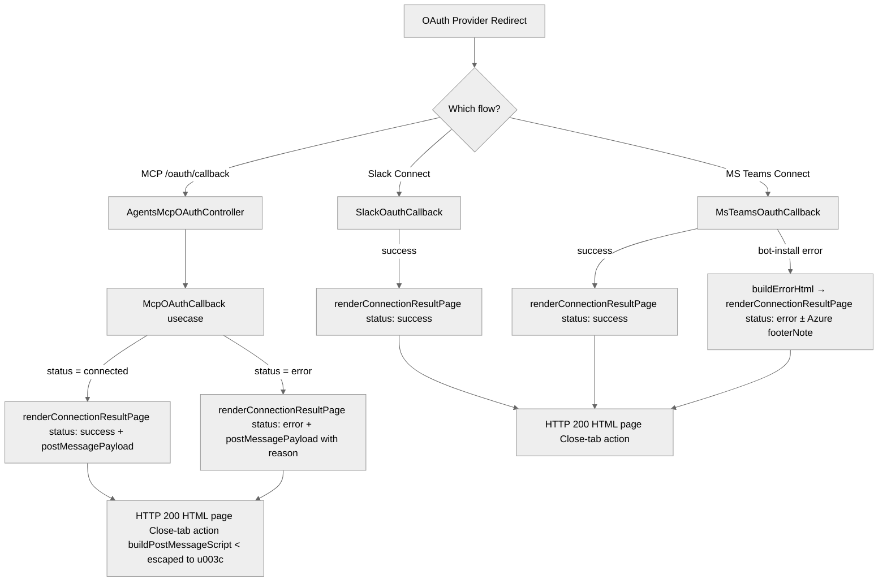

# feat(api-service): show flow-complete page after MCP/Connect OAuth instead of dashboard redirect or blank tab

<!-- CURSOR_AGENT_PR_BODY_BEGIN -->
### What changed? Why was the change needed?

Two server-rendered OAuth endings produced poor terminal pages:

- **Agent MCP OAuth** redirected to `${DASHBOARD_URL}/agents/mcp/oauth/result` — a dashboard route that is not implemented (and otherwise fell back to a bare `window.close()` page).
- **React `Connect` flow** (Slack / MS Teams) returned `<script>window.close();</script>`, which renders as a blank tab.

Both now render a shared **"flow complete"** HTML page styled after the agent email action-button landing pages.

---

### Review fixes (Greptile) — commit `f5eaa3aa37`

- **XSS:** `buildPostMessageScript` replaces `<` with `\u003c` in serialized JSON so `</script>` in OAuth `error_description` cannot break out of the inline script. ([discussion](https://github.com/novuhq/novu/pull/11372#discussion_r3330021086))
- **Consistency:** MS Teams `buildErrorHtml` now uses `renderConnectionResultPage`.

### Copy pass — commit `4623360838`

Removed duplicated text (message + footer both said "return to where you started") and softened tone. Each page now shows a heading + a single concise message; the "Close this tab" link is the only CTA.

| State | Heading | Message |
| --- | --- | --- |
| Success (MCP/Slack/Teams) | You're all set | Your MCP server / Slack workspace / Microsoft Teams is connected and ready to use. |
| MCP error | We couldn't connect | Something went wrong while connecting your MCP server. Please go back and try again. |
| Teams setup error | We couldn't set up Microsoft Teams | <technical reason> (+ Azure-propagation footer when relevant) |

---

### Screenshots

MCP success:


MCP error:


Slack Connect success:


MS Teams setup error (shared renderer):


<details>
<summary><strong>Expand for optional sections</strong></summary>

### Special notes for your reviewer

`msteams-oauth-callback.usecase.spec.ts` — 13 passing. Inline code comments document the postMessage escaping and `buildErrorHtml` migration. Existing e2e/spec assertions still match (titles `Connection complete` / `Connection failed` and the Teams success string are preserved).

</details>
<!-- CURSOR_AGENT_PR_BODY_END -->

<div><a href="https://cursor.com/agents/bc-0e891faa-5e67-40ca-850e-46f8b5f59e9e"><picture><source media="(prefers-color-scheme: dark)" srcset="https://cursor.com/assets/images/open-in-web-dark.png"><source media="(prefers-color-scheme: light)" srcset="https://cursor.com/assets/images/open-in-web-light.png"></picture></a>&nbsp;<a href="https://cursor.com/background-agent?bcId=bc-0e891faa-5e67-40ca-850e-46f8b5f59e9e"><picture><source media="(prefers-color-scheme: dark)" srcset="https://cursor.com/assets/images/open-in-cursor-dark.png"><source media="(prefers-color-scheme: light)" srcset="https://cursor.com/assets/images/open-in-cursor-light.png"></picture></a>&nbsp;</div>


<!-- This is an auto-generated comment: release notes by coderabbit.ai -->
## What changed

OAuth terminal flows for Agent MCP, Slack Connect, and Microsoft Teams now render a shared, styled "connection result" HTML page (HTTP 200) that shows success or error messaging and a clear "Close this tab" action. This replaces prior redirects to an unimplemented dashboard route or bare window.close() scripts that produced blank tabs, improving end-user UX and providing a reliable way for clients to detect OAuth outcomes.

## Affected areas

**api**: MCP, Slack, and MS Teams OAuth callback handlers now return the server-rendered connection result page and, for MCP, attempt a best-effort novuhq-mcp-oauth-result postMessage to same-origin openers; MS Teams error rendering was migrated to the shared renderer while preserving an Azure permission-propagation footer for specific permission errors.

**shared**: Added apps/api/src/app/shared/html/connection-result-page.ts which exposes renderConnectionResultPage(), types, and helpers to generate the self-contained HTML (icons, dark-mode CSS, close handler, and optional postMessage script). All user-facing strings are escaped and the postMessage payload is JSON-escaped to prevent </script>-injection XSS.

**tests**: Updated unit/usecase and E2E tests to assert HTTP 200 responses and validate the rendered page content (MCP e2e and MS Teams/Slack callback specs) instead of expecting redirects or raw close-tab scripts.

## Key technical decisions

- Use a single server-rendered HTML page for all OAuth terminal states to unify UX and reduce duplicated fallback logic.  
- Deliver outcome signals to same-origin openers via postMessage with JSON-escaping to mitigate script-injection XSS.

## Testing

Updated automated tests include modified usecase specs and E2E assertions that check status 200 and rendered page contents; manual browser verification of close-tab behavior and postMessage receipt is recommended.
<!-- end of auto-generated comment: release notes by coderabbit.ai -->

<!-- greptile_comment -->

<h3>Greptile Summary</h3>

This PR replaces two broken OAuth terminal flows — an MCP redirect to an unimplemented dashboard route and a bare `window.close()` script tab — with a shared, styled "connection result" HTML page rendered by the new `renderConnectionResultPage()` helper. It also addresses two previously flagged issues: XSS in the postMessage payload serialization and the inconsistent bespoke `buildErrorHtml` template in the MS Teams callback.

- **`connection-result-page.ts`** (new): self-contained HTML renderer with full `escapeHtml()` coverage for all user-visible fields, animated success/error card, dark-mode CSS, and a `buildPostMessageScript()` that escapes `<` → `\\u003c` to prevent `</script>` injection in provider-controlled `error_description` values.
- **MCP, Slack, MS Teams callbacks**: `SCRIPT_CLOSE_TAB` / redirect logic removed; all three now delegate to `renderConnectionResultPage()`. MS Teams' `buildErrorHtml` migrated to the shared renderer, preserving the Azure permission-propagation footer note.
- **Tests**: E2E and usecase specs updated to assert HTTP 200 and presence of expected heading text instead of redirect codes or raw `window.close()` strings.

<h3>Confidence Score: 5/5</h3>

Safe to merge — all dynamic content is HTML-escaped, the </script> injection vector is properly mitigated, and both previously flagged issues are resolved.

The change introduces a single new pure-function renderer where every user-supplied string passes through escapeHtml() before entering the HTML body, and JSON.stringify output is further sanitised with the \u003c substitution before being embedded in script blocks. The two issues raised in prior review rounds are addressed. Tests verify both success and error paths with explicit body-content assertions.

No files require special attention.

<details><summary><h3>Important Files Changed</h3></summary>


| Filename | Overview |
|----------|----------|
| apps/api/src/app/shared/html/connection-result-page.ts | New shared renderer; all dynamic content is properly HTML-escaped, XSS via </script> is fixed by replacing < with \u003c in JSON before embedding in script tags. |
| apps/api/src/app/agents/mcp/oauth/agents-mcp-oauth.controller.ts | Replaced redirect/fallback with renderConnectionResultPage(); user-visible message is hardcoded, provider error only flows into the postMessage payload where it is safely escaped. |
| apps/api/src/app/integrations/usecases/chat-oauth-callback/msteams-oauth-callback/msteams-oauth-callback.usecase.ts | Migrated SCRIPT_CLOSE_TAB and buildErrorHtml to the shared renderer; message passed to renderConnectionResultPage is HTML-escaped inside the renderer. |
| apps/api/src/app/integrations/usecases/chat-oauth-callback/slack-oauth-callback/slack-oauth-callback.usecase.ts | Replaced SCRIPT_CLOSE_TAB with renderConnectionResultPage() on the success path; no functional change other than the improved terminal page. |
| apps/api/src/app/integrations/usecases/chat-oauth-callback/msteams-oauth-callback/msteams-oauth-callback.usecase.spec.ts | Spec assertions updated to match the new HTML output; all four close-tab scenarios now check for 'Microsoft Teams is connected' heading text. |
| apps/api/src/app/agents/e2e/agent-mcp-servers.e2e.ts | E2E assertions tightened from [200, 302] to strict 200 plus HTML body content checks; accurately reflects the new always-200 contract. |

</details>


</details>


<h3>Flowchart</h3>



<!-- greptile_failed_comments -->
<details><summary><h3>Comments Outside Diff (1)</h3></summary>

1. `apps/api/src/app/integrations/usecases/chat-oauth-callback/msteams-oauth-callback/msteams-oauth-callback.usecase.ts`, line 309-347 ([link](https://github.com/novuhq/novu/blob/5c84b09a624528167e90bcd5df727238e9ea925c/apps/api/src/app/integrations/usecases/chat-oauth-callback/msteams-oauth-callback/msteams-oauth-callback.usecase.ts#L309-L347)) 

   <a href="#"></a> **`buildErrorHtml` not migrated to the shared renderer**

   The PR introduces `renderConnectionResultPage` as the canonical shared HTML renderer and migrates the close-tab responses, but `buildErrorHtml` still generates its own bespoke HTML with separate styles. The error page will now look visually inconsistent with every other terminal page returned by this service. Consider wrapping the permission-error content in `renderConnectionResultPage` (status `'error'`) with the `footerNote` field carrying the Azure-propagation hint, or at minimum make `buildErrorHtml` reuse the exported `escapeHtml` helper to avoid duplicated escaping logic.

   <details><summary>Prompt To Fix With AI</summary>

   `````markdown
   This is a comment left during a code review.
   Path: apps/api/src/app/integrations/usecases/chat-oauth-callback/msteams-oauth-callback/msteams-oauth-callback.usecase.ts
   Line: 309-347

   Comment:
   **`buildErrorHtml` not migrated to the shared renderer**

   The PR introduces `renderConnectionResultPage` as the canonical shared HTML renderer and migrates the close-tab responses, but `buildErrorHtml` still generates its own bespoke HTML with separate styles. The error page will now look visually inconsistent with every other terminal page returned by this service. Consider wrapping the permission-error content in `renderConnectionResultPage` (status `'error'`) with the `footerNote` field carrying the Azure-propagation hint, or at minimum make `buildErrorHtml` reuse the exported `escapeHtml` helper to avoid duplicated escaping logic.

   How can I resolve this? If you propose a fix, please make it concise.
   `````
   </details>

   Note: If this suggestion doesn't match your team's coding style, reply to this and let me know. I'll remember it for next time!

   <a href="https://app.greptile.com/api/ide/cursor?prompt=This%20is%20a%20comment%20left%20during%20a%20code%20review.%0APath%3A%20apps%2Fapi%2Fsrc%2Fapp%2Fintegrations%2Fusecases%2Fchat-oauth-callback%2Fmsteams-oauth-callback%2Fmsteams-oauth-callback.usecase.ts%0ALine%3A%20309-347%0A%0AComment%3A%0A**%60buildErrorHtml%60%20not%20migrated%20to%20the%20shared%20renderer**%0A%0AThe%20PR%20introduces%20%60renderConnectionResultPage%60%20as%20the%20canonical%20shared%20HTML%20renderer%20and%20migrates%20the%20close-tab%20responses%2C%20but%20%60buildErrorHtml%60%20still%20generates%20its%20own%20bespoke%20HTML%20with%20separate%20styles.%20The%20error%20page%20will%20now%20look%20visually%20inconsistent%20with%20every%20other%20terminal%20page%20returned%20by%20this%20service.%20Consider%20wrapping%20the%20permission-error%20content%20in%20%60renderConnectionResultPage%60%20%28status%20%60'error'%60%29%20with%20the%20%60footerNote%60%20field%20carrying%20the%20Azure-propagation%20hint%2C%20or%20at%20minimum%20make%20%60buildErrorHtml%60%20reuse%20the%20exported%20%60escapeHtml%60%20helper%20to%20avoid%20duplicated%20escaping%20logic.%0A%0AHow%20can%20I%20resolve%20this%3F%20If%20you%20propose%20a%20fix%2C%20please%20make%20it%20concise.&pr=11372&platform=github"><picture><source media="(prefers-color-scheme: dark)" srcset="https://greptile-static-assets.s3.amazonaws.com/badges/FixInCursorDark.svg?v=3"><source media="(prefers-color-scheme: light)" srcset="https://greptile-static-assets.s3.amazonaws.com/badges/FixInCursor.svg?v=3"></picture></a>
</details>

<!-- /greptile_failed_comments -->

<sub>Reviews (4): Last reviewed commit: ["refactor(api): tighten OAuth flow-comple..."](https://github.com/novuhq/novu/commit/4623360838b4c60717671b9d3b9aee69f25b931e) | [Re-trigger Greptile](https://app.greptile.com/api/retrigger?id=34780739)</sub>

<!-- /greptile_comment -->
