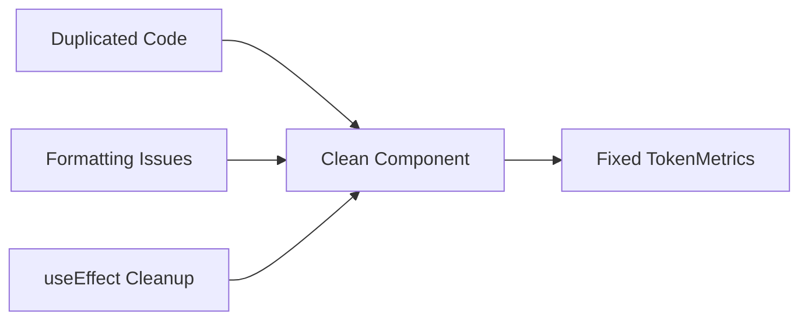

# Fix TokenMetrics component

## **User description**
### **User description**
## Summary
- clean up `TokenMetrics` component
- remove duplicated markup
- keep live time update logic

## Testing
- `npm test` *(fails: No test files found)*
- `npm run lint` *(fails: 113 errors, 15 warnings)*

------
https://chatgpt.com/codex/tasks/task_e_688b1692c6a0832f804acd443cc759c5

___

### **PR Type**
Bug fix

___

### **Description**
- Remove duplicated component markup and function parameters

- Fix indentation and formatting inconsistencies

- Clean up useEffect implementation for time updates

- Remove commented code and unused imports

___

### Diagram Walkthrough

 
<h3> File Walkthrough</h3>

<table><thead><tr><th></th><th align="left">Relevant files</th></tr></thead><tbody><tr><td><strong>Bug fix</strong></td><td><table>
<tr>
  <td>
    

      
<strong>TokenMetrics.tsx</strong><dd><code>Clean up duplicated code and formatting</code>&nbsp; &nbsp; &nbsp; &nbsp; &nbsp; &nbsp; &nbsp; &nbsp; &nbsp; &nbsp; &nbsp; &nbsp; &nbsp; &nbsp; &nbsp; &nbsp; &nbsp; &nbsp; </dd>

src/components/TokenMetrics.tsx

<ul><li>Remove duplicated function parameters and component markup  <li> Fix indentation and spacing throughout the file  <li> Clean up useEffect implementation for time interval  <li> Remove commented code and unused hook references</ul>

  </td>
  <td><a href="https://github.com/numbpill3d/cyber-prompt-builder/pull/42/files#diff-d330c89c3846394b4c94d0fde7cdf22a3ff30bebd9c600f7d19df7dca5b57b8a">+21/-37</a>&nbsp; </td>

</tr>
</table></td></tr></tr></tbody></table>

___

___

## **CodeAnt-AI Description**
**Fix the TokenMetrics display**

### What Changed
- Removed duplicated status markup so the metrics card shows one status row instead of repeated content
- Kept the live time display working while cleaning up the component layout
- Fixed spacing and indentation so the TokenMetrics section renders consistently

### Impact
`✅ Cleaner token metrics display`
`✅ Fewer duplicated status details`
`✅ Preserved live time updates`

<strong>💡 Usage Guide</strong>

### Checking Your Pull Request
Every time you make a pull request, our system automatically looks through it. We check for security issues, mistakes in how you're setting up your infrastructure, and common code problems. We do this to make sure your changes are solid and won't cause any trouble later.

### Talking to CodeAnt AI
Got a question or need a hand with something in your pull request? You can easily get in touch with CodeAnt AI right here. Just type the following in a comment on your pull request, and replace "Your question here" with whatever you want to ask:
<pre>
<code>@codeant-ai ask: Your question here</code>
</pre>
This lets you have a chat with CodeAnt AI about your pull request, making it easier to understand and improve your code.

#### Example
<pre>
<code>@codeant-ai ask: Can you suggest a safer alternative to storing this secret?</code>
</pre>

### Preserve Org Learnings with CodeAnt
You can record team preferences so CodeAnt AI applies them in future reviews. Reply directly to the specific CodeAnt AI suggestion (in the same thread) and replace "Your feedback here" with your input:
<pre>
<code>@codeant-ai: Your feedback here</code>
</pre>
This helps CodeAnt AI learn and adapt to your team's coding style and standards.

#### Example
<pre>
<code>@codeant-ai: Do not flag unused imports.</code>
</pre>

### Retrigger review
Ask CodeAnt AI to review the PR again, by typing:
<pre>
<code>@codeant-ai: review</code>
</pre>

### Check Your Repository Health
To analyze the health of your code repository, visit our dashboard at [https://app.codeant.ai](https://app.codeant.ai). This tool helps you identify potential issues and areas for improvement in your codebase, ensuring your repository maintains high standards of code health.

